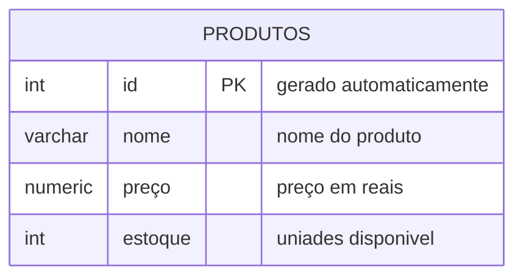
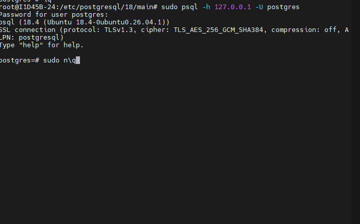

## AULA 02
comando para apagar um banco de dados 

```sql
DROP DATABASE lojamax;
```
comando para criar um banco de dados
```SQL
CREATE DATABASE lojamax;
```


---
o objetivo é criar uma loja para aprender os principais comandos SQL.


---

para criar os comandos, ultilizamos os comandos abaixo 
```SQL
CREATE TABLE produtos (
    id INT GENERATED ALWAYS AS IDENTITY PRIMARY KEY,
    nome VARCHAR(50) NOT NULL,
    preco NUMERIC(10,2) NOT NULL,
    estoque INT NOT NULL DEFAULT 0
);
```
# Atividade 04
-Criem um novo banco de dados chamado: cidades

usaremos os codigos:
```bash
sudo psql -h 127.0.0.1 -U postgres
```




# Print da atividade
Criando o banco de dados chamado Cidades


---

Logo depois puxei o banco de dados para o vscode


---
Criando a tabela utilizei o seguinte comando:
```sql
CREATE TABLE maioresCidades (
id INT GENERATED ALWAYS AS IDENTITY PRIMARY KEY,
nome VARCHAR(50) NOT NULL,
 populacao INT NOT NULL);

```
assim foi criado a tabela maioresCidades

---

Logo depois adicionei os valore com o seguinte comando:
```sql
INSERT INTO maiorescidades (nome, populacao)
VALUES
('Tóquio', 37000000),
('Délhi', 34000000),
('Xangai', 30000000),
('Daca', 24000000),
('São Paulo', 23000000);
```
--- 

Depois verifiquei como ficou a tabela utilizando o comando:
```sql
SELECT * FROM maioresCidades
```


